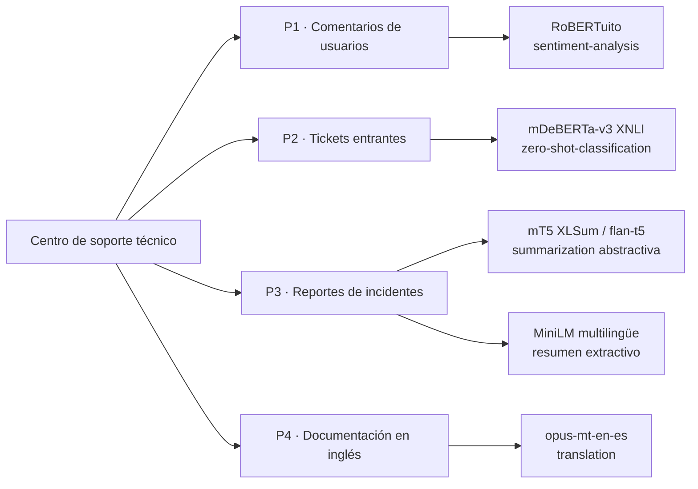
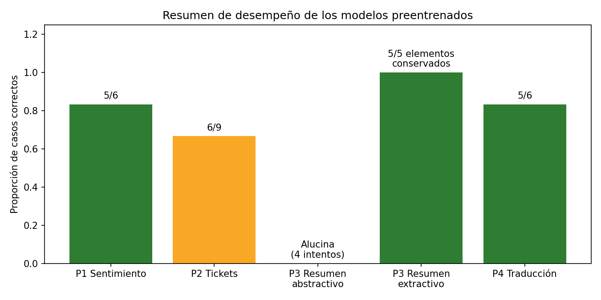
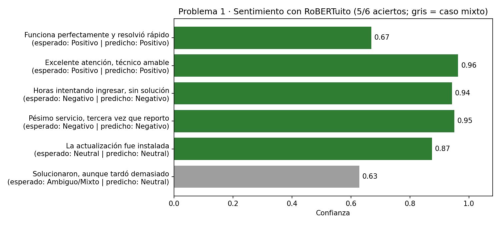
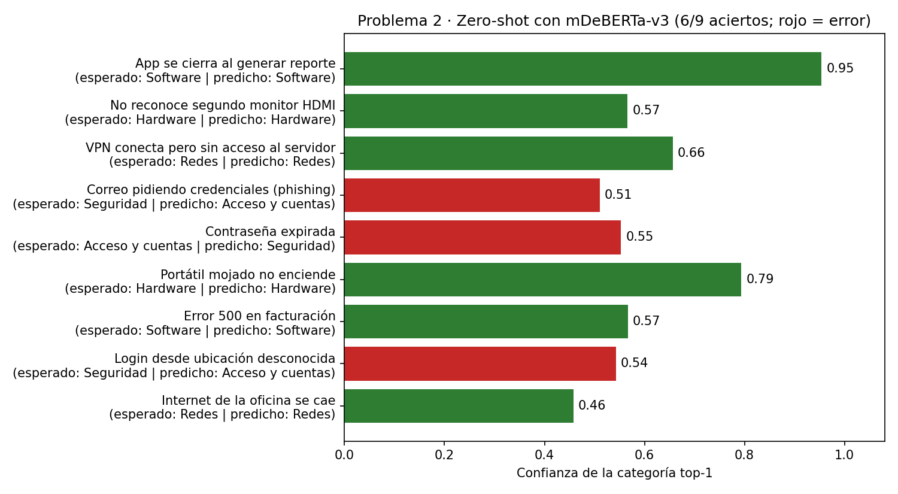
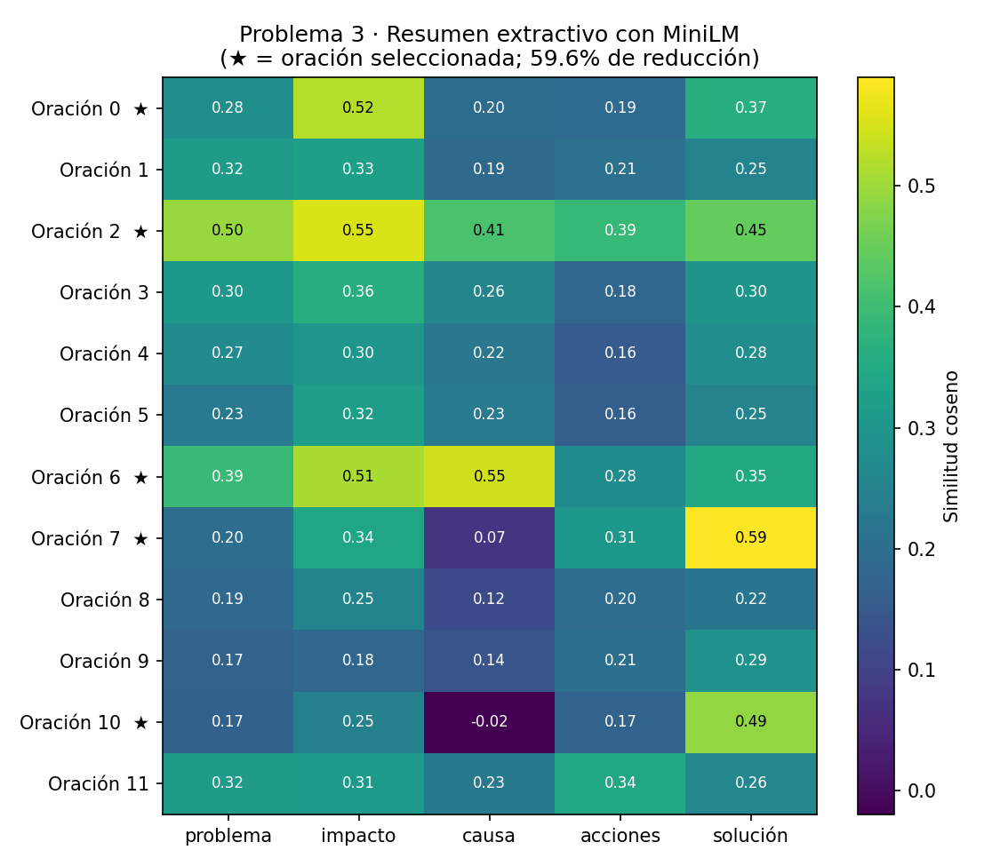

# Transformers aplicados a Soporte Técnico

**Universidad de La Salle · Maestría en Inteligencia Artificial · Aplicaciones II (Grupo 01)**
Actividad 5: *Descifrando soluciones prácticas con Transformers* — Ing. Camilo Andrés Castañeda Galindo


## Descripción

Este proyecto evalúa de forma práctica y crítica **qué tan efectivos son varios modelos Transformer preentrenados de Hugging Face** al aplicarse, *sin entrenamiento adicional*, a un escenario real de un centro de soporte técnico. Se definen casos de prueba controlados (comentarios de usuarios, tickets, un reporte de incidente y documentación en inglés) para identificar fortalezas y limitaciones de cada modelo.



## Resumen de resultados



| # | Problema | Modelo | Resultado |
|---|---|---|---|
| 1 | Análisis de sentimientos (ES) | [`pysentimiento/robertuito-sentiment-analysis`](https://huggingface.co/pysentimiento/robertuito-sentiment-analysis) | **5/6** aciertos. Robusto en casos polarizados; el comentario mixto se clasifica como *Neutral* con baja confianza. |
| 2 | Clasificación de tickets (zero-shot) | [`MoritzLaurer/mDeBERTa-v3-base-xnli-multilingual-nli-2mil7`](https://huggingface.co/MoritzLaurer/mDeBERTa-v3-base-xnli-multilingual-nli-2mil7) | **6/9** aciertos. Falla al distinguir *Seguridad* vs. *Acceso y cuentas* (categorías semánticamente solapadas). |
| 3a | Resumen abstractivo de incidentes | [`csebuetnlp/mT5_multilingual_XLSum`](https://huggingface.co/csebuetnlp/mT5_multilingual_XLSum), [`google/flan-t5-base`](https://huggingface.co/google/flan-t5-base) | **Alucina** en los 4 intentos (directo, beam search, flan-t5, map-reduce): inventa entidades como "Microsoft" o "Reino Unido". |
| 3b | Resumen extractivo de incidentes | [`sentence-transformers/paraphrase-multilingual-MiniLM-L12-v2`](https://huggingface.co/sentence-transformers/paraphrase-multilingual-MiniLM-L12-v2) | **59.6 %** de reducción conservando problema, impacto, causa, acción y solución, sin alucinaciones. |
| 4 | Traducción técnica EN → ES | [`Helsinki-NLP/opus-mt-en-es`](https://huggingface.co/Helsinki-NLP/opus-mt-en-es) | **5/6** traducciones correctas. Error en verbos idiomáticos: *"rolled back"* → *"se rodó"*. |

## Resultados por problema

### Problema 1 · Análisis de sentimientos


La confianza baja aparece justo en los comentarios con matices, lo que puede usarse como señal para enviar esos casos a revisión humana.

### Problema 2 · Clasificación automática de tickets


Excelente en categorías con vocabulario técnico distintivo (Software, Hardware, Redes). En los tres errores la categoría correcta quedó en segundo lugar del ranking.

### Problema 3 · Resumen de incidentes técnicos
Los modelos abstractivos presentaron desajuste de dominio (mT5 fue afinado sobre noticias de la BBC) o límite de contexto (flan-t5: 512 tokens frente a 1081 del reporte). Como alternativa se construyó un **resumen extractivo**: se calculan embeddings de cada oración y se comparan, mediante similitud coseno, con cinco criterios semánticos (problema, impacto, causa, acciones, solución).



### Problema 4 · Traducción técnica
Conserva correctamente términos como *endpoint*, *PostgreSQL* y *backend*, y traduce *reverse proxy* → *proxy inverso*. Falla en la oración más compleja:

> **EN:** The deployment pipeline **rolled back** automatically…
> **ES:** La tubería de despliegue **se rodó** automáticamente…

## Conclusiones

- Los modelos preentrenados funcionan bien en tareas de **clasificación** y **traducción** de complejidad baja-media.
- Para **resumir textos técnicos**, un enfoque **extractivo** con embeddings es más fiable que uno abstractivo genérico, porque no inventa hechos y es trazable.
- Las salidas con baja confianza o en dominios críticos deben pasar por **revisión humana**. Para mejorar se recomienda *fine-tuning* con datos propios, *few-shot* o fusionar categorías solapadas.

## Estructura del repositorio

```
├── Actividad_5_Transformers_SoporteTecnico_ECO_Camilo.ipynb   # Notebook principal
├── images/                                                    # Figuras del README
├── scripts/generar_figuras.py                                 # Genera las figuras a partir de los resultados
└── requirements.txt
```

## Cómo ejecutar

```bash
pip install -r requirements.txt
jupyter notebook Actividad_5_Transformers_SoporteTecnico_ECO_Camilo.ipynb
```

El notebook detecta automáticamente si hay GPU (CUDA); de lo contrario se ejecuta en CPU. Los modelos se descargan desde Hugging Face en la primera ejecución.
